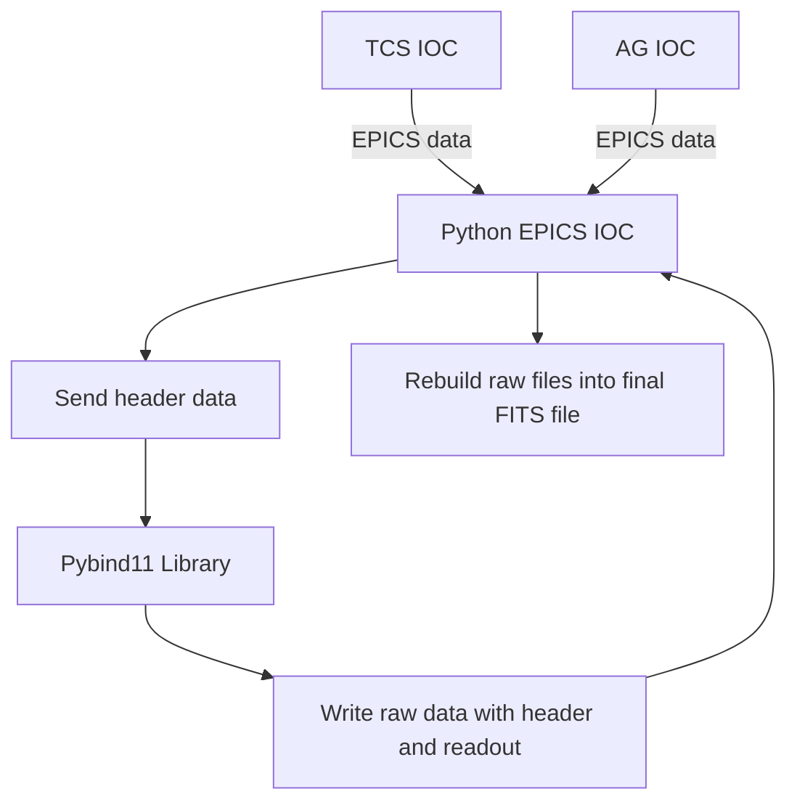
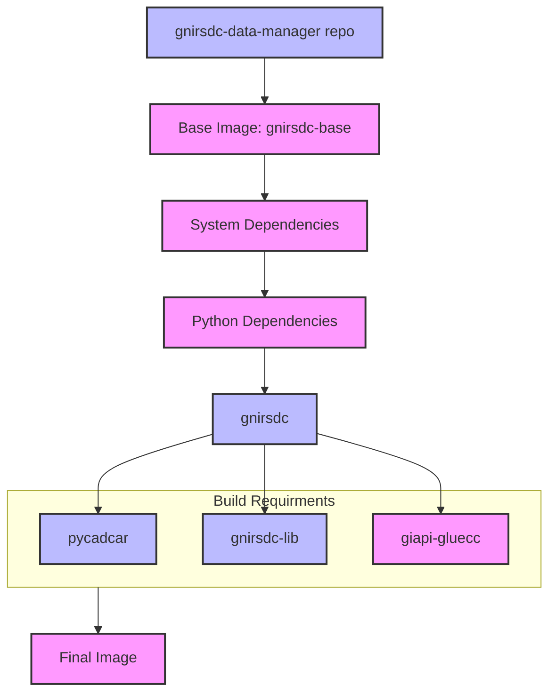

# Detector Controller Software

The DC software is a collection of Python scripts and Bash scripts for managing the Detector Controller Software and GMP containers. It is designed to work with an SDSU ARC (San Diego State University Astronomical Research Cameras) controller.

The software is run in Docker containers, providing isolation and portability. It can be interfaced with through either an HTML-based [System Manager](#system-manager), a PyDM screen, or Bash control scripts.

The GMP (Gemini Master Process) is used for GIAPI (Gemini Instrument Application Programming Interface) communication. It works in conjunction with the GDS (Gemini Data System) to process FITS files.

## Quick Start Guide

1. **Ensure the ARC controller is powered on**
   - Follow the Quick Fix page instructions to power cycle GNIRS DC.
   - You will see the ARC controller listed on the bootbar.
   - The status should be green indicating the controller is powered on.
   - If it is off you can power it on from the bootbar page.

2. **Access the System Manager**
   - Open a web browser and navigate to:
     ```
     http://gn-irdc-lp3:8080
     ```
   - This will open the System Manager interface, showing the Monitoring tab.

3. **Verify that the DC Software is running**
   - On the Monitoring tab, check the "GNIRS DC Health:" display.
   - Ensure that the green heartbeat indicator is blinking.

4. **Initialize the Detector Controller**
   - On the Monitoring tab, click the "Initialize Controller" button.
   - Select "Initialize Controller".
   - Click on the "Apply" button.
   - The "Controller Initialized:" status indicator should be green.

5. **Troubleshooting the DC Software**

   - **If the System Manager doesn't open**
      - SSH into the IRDC server:
     ```
     ssh telops@gn-irdc-lp3
     ```
      - Start the System Manager with the following command:
     ```
     dc-system-manager.sh
     ```
      - Open a web browser and navigate to `http://gn-irdc-lp3:8080`

   - **If the DC is not running**
      - Locate "Select Action" dropdown menu.
      - Select "Start Controller".
      - Wait for the DC to initialize.
      - Check the "GNIRS DC Health:" display again.
      - It may take a minute but should not take much more than that.
      - If the System Manager gives you SSH errors, see the SSH [Troubleshooting Issues on the IRDC Server with the Telops User](#ssh-authentication-issues-on-the-irdc-server-with-the-telops-user) section below.
         
      - If the DC is still not running, try the following:
         - Open a terminal and run the following command to SSH into the server:
     ```
     ssh telops@gn-irdc-lp3
     ```
         - Check the status of the DC software:
     ```
     dc-status.sh
     ```
         - You should see something like this:
     ```
     CONTAINER ID   IMAGE                                                                                              NAMES
     1ac26040939c   registry...gnirsdc-run:current   "/gnirsdc/entrypoint…"   4 seconds ago   Up 3 seconds             gnirsdc
     05f3dde51464   registry...gmp-server:current    "/usr/local/bin/entr…"   4 seconds ago   Up 3 seconds             gmp
     ```


      - You should see the "**gnirsdc**" and "**gmp**" containers running
      - If you don't see this, something is wrong with the DC software.
      - Start the DC software manually with the following command:
     ```
     dc-start.sh
     ```
      - Check the status again.
      - If you still don't see it, contact software for support and check the logs for errors:
     ```
     tail -f /readout_data/logs/irdc.log
     ```

7. **Set Temperature Override (if needed)**
   <div style="color: red; font-weight: bold;">
       Warning: Overriding the temperature interlock can cause damage to the detector.
   </div>

   - Navigate to the Engineering tab by clicking "Engineering" in the top navigation bar.
   - Find the "Temperature Interlock Override" section.
   - Toggle the switch to enable or disable the temperature interlock override.
   - This allows operation even if the detector temperature is outside the normal range.


## Detector Controller Usage

1. SSH to one of the required IRDC servers (gn-irdc-lp1, gn-irdc-lp2, gn-irdc-lp3)

2. Start the [System Manager](#system-manager):

   ```
   dc-system-manager.sh
   ```

   If the DC is running in debug mode the System Manager must be started with the `--debug` option:

   ```
   dc-system-manager.sh --debug
   ```   

   Note: This script must be run as the telops user. Ensure that the telops user has an SSH key set up before starting the System Manager.

3. Open a web browser and navigate to `http://<server ip address>:8080`

4. Use the System Manager web interface to monitor and configure the Detector Controller Software.

Alternatively, you can use the following commands to manage the Detector Controller Software and GMP containers:

- To start:
  ```
  dc-start.sh [additional arguments]
  ```
  Example with additional arguments:
  ```
  dc-start.sh --top tgnirs
  ```

- To stop:
  ```
  dc-stop.sh
  ```

- To check status:
  ```
  dc-status.sh
  ```

## DM Screen Usage

From a workstation with access to the IRDC server (currently hbfcon03 and mkocon05)

```
irdc_dm.sh
```

From a remote system

```
ssh -X <irdc server> "irdc_dm_server.sh"
```
or 

```
ssh -X <irdc server> 
irdc_dm_server.sh
```

## Data Retrieval

Raw data is stored in the `/readout_data/fits` directory on the IRDC server.

```
/readout_data/fits
```

Once processed the data is moved to the `/staging/perm` directory on the IRDC server.

```
/staging/perm
```

Use the web interface to navigate to the data and download it to a local system for viewing.

Alternatively you can scp the data to a local system for viewing.

Example:

``` 
scp <user>@<server>:/readout_data/fits/* .
```


## Detector Controller (DC) Operation Scripts

### dc-start.sh
Starts the Detector Controller Software and related Docker containers.
```
Usage: dc-start.sh [additional arguments]
```
- Additional arguments are passed to the `gnirsdc` container.
- Example: `dc-start.sh --top tgnirs` (for debug mode)

### dc-stop.sh
Stops the Detector Controller Software and removes related Docker containers.
```
Usage: dc-stop.sh
```
- No additional flags or arguments.

### dc-status.sh
Checks and displays the status of the Detector Controller Software containers.
```
Usage: dc-status.sh
```
- No additional flags or arguments.
- Displays running status of `gnirsdc` and `gmp` containers.

### dc-system-manager.sh
Launches the System Manager web interface for monitoring and controlling the DC software.
```
Usage: dc-system-manager.sh [--debug]
```
- `--debug`: Starts the System Manager in debug mode.
- `--help`: Displays help information.

### dc-devel.sh
Starts Docker containers for the Detector Controller Software in a development environment.
```
Usage: dc-devel.sh
```
- No additional flags or arguments.
- Attempts to start containers with development images.

### dc-production.sh
Updates Docker images by pulling the latest 'production' tag and tagging it as 'current'.
```
Usage: dc-production.sh
```
- No additional flags or arguments.
- Ensures 'current' tag points to the latest 'production' version.

### dc-latest.sh
Updates Docker images by pulling the latest 'latest' tag and tagging it as 'current'.
```
Usage: dc-latest.sh
```
- No additional flags or arguments.
- Ensures 'current' tag points to the most recent 'latest' version.

### dc-promote.sh
Promotes Docker images from 'current' to 'production' tag, archiving the old 'production' image.
```
Usage: dc-promote.sh [--help]
```
- `--help`: Displays help information about the script's functionality.

Note: These scripts should be run with appropriate permissions, typically as the 'telops' user or a user with Docker access.   

## Note

Your user on the IRDC server must be a memeber of the docker group

## Driver 

The DC uses the SDSU PCIe driver. The driver is officially supported on linux kernel 2 and 3. We run it on kernel 4. We have not had kernel issues on kernel version 4.18.0-348.20.1.el8_5.x86_64 and older.

``` 
Kernel on gn-irdc-lp1 and gn-irdc-lp3
4.18.0-348.20.1.el8_5.x86_64
```

The driver code and installation instruction are in this repository:

``` 
https://gitlab.com/nsf-noirlab/gemini/rtsw/iocs/gnirs-pci-driver
```

## Docker Login

**Note:** If `dc-latest.sh` doesn't work, you may need to log in to Docker.

Docker login is required to pull the images that the DC and DM screens are deployed in. The telops user has access to start/stop the containers but does not have access to gitlab registry. A user with access to the registry is needed to pull the images.

### GitLab Docker Login with Personal Access Token Using `--password-stdin` Option

**Login to GitLab Website:**

Navigate to your GitLab instance (e.g., https://gitlab.com) and log in with your credentials.

**Create a Personal Access Token:**

1. Click on your profile avatar and select **"Edit profile"**.
2. Go to **"Access Tokens"**.
3. Enter a name for the token (e.g., `Docker Registry Access`).
4. Set an expiration date (optional but recommended).
5. Select the scopes:
   - `read_registry`
   - `read_repository`
6. Click on **"Create personal access token"**.
7. **Important:** Copy the generated token. You won't be able to see it again.

**Docker Login Using `--password-stdin`:**

For enhanced security, use the `--password-stdin` option to avoid exposing your access token in the shell history.

```
echo "your-personal-access-token" | docker login registry.gitlab.com -u your-gitlab-username --password-stdin
```

- Replace \`your-gitlab-username\` with your actual GitLab username.
- Replace \`your-personal-access-token\` with the token you copied earlier.

**Example:**

```
echo "glpat-xxxxxxxxxxxxxx" | docker login registry.gitlab.com -u johndoe --password-stdin
```

**Note:** Ensure that your user on the IRDC server is a member of the \`docker\` group.


# How to Build gnirsdc-lib

The gnirsdc-lib is a C++ library with Python bindings (using Pybind11) designed to control the SDSU ARC (San Diego State University Astronomical Research Cameras) controller. It handles firmware loading and execution of firmware calls.

To build the library:

1. **Clone the Repository:**

   ```
   git clone git@gitlab.com:nsf-noirlab/gemini/rtsw/iocs/gnirsdc-lib.git
   ```

2. **Setup Development Environment:**
   - Open the cloned directory in Visual Studio Code.
   - Use the Command Palette (Ctrl+Shift+P) to start the development container.

3. **Build Process:**
   The project uses a GitLab CI/CD pipeline for automated building and deployment:
   - It creates a Docker image for the build environment.
   - Builds the library within this container.
   - If changes are detected in `libgnirsioc.so`, it commits and pushes these changes.
   - Triggers a deployment in the `gnirsdc-data-manager` project to use the updated library.

4. **Manual Build (if needed):**
   Inside the development container:

   ```
   make clean all
   ```
   
   ```
   pip3.9 install .
   ```

This process ensures that the library is built consistently and that dependent projects are updated accordingly.


## VSCode
## dev con
## pip3.9 install . 
### rm /usr/local/lib64/python3.9/site-packages/libgnirsioc.so 
### etc
## pipeline generated commit

# libgnirsioc python cmd line use

# how do run debug modes
## collect_dataset.py


# run dm screen
## linux
## mac
### export DISPLAY=host.docker.internal:0
### ./irdc_dm_server.sh

# debug mode in vscode

# gnirs-lib manual build
## /gnirsdc-lib
## make
## pip3.9 install .

# git setup 
## [root@docker-desktop gnirsdc-lib]# git config --global user.name "Hawi Stecher"
## [root@docker-desktop gnirsdc-lib]# git config --global user.email "hawi.stecher@noirlab.edu"

# dev container
## docker pull
## rebuild


Future notes:
IRDC Documentation Notes
Driver documentation
Kernel version
Repo
Build
Install
troubleshooting
DM Screen
Repo
Build
Install
Run
Use


for debug in vscode you must "tar -xvf giapi-gluecc_rocky8.tar.gz"


# System Manager

The System Manager is a web-based interface for monitoring and configuring the Detector Controller Software. It provides an easy-to-use interface for viewing system status, editing configuration files, and performing various actions.

## Usage

The System Manager must be started with the telops user. The telops user must have an SSH key set up before starting the System Manager. If you haven't set up an SSH key yet, you can do so by running:

```
ssh-keygen
```

To start the System Manager, use the provided script:

```
dc-system-manager.sh
```

This script will:
1. Check if it's being run by the telops user
2. Remove any existing System Manager container
3. Start a new System Manager container with the necessary configurations

Options:
- `--help`: Display help information
- `--debug`: Start the System Manager Server in debug mode

Example usage:
```
dc-system-manager.sh --debug
```

After starting the System Manager, open a web browser and navigate to `http://localhost:8080` (or the appropriate IP address if accessing remotely).

## Features

The System Manager offers several features accessible through different tabs:

1. **Monitoring**: View the current status of the system, including:
   - GNIRS DC Health
   - GNIRS DC State
   - Epics Top
   - GDS Connection
   - TCS Connection
   - Temperature
   - Controller Initialization
   - Temperature Interlock
   - Detector Bias Voltage

2. **Config Editor**: Edit the configuration file directly through the web interface.

3. **Logs**: View and download log files.

4. **FITS Files**: Browse and download FITS files from both staging and readout directories.

5. **README**: View the README file with a table of contents for easy navigation.

### Monitoring Tab

The monitoring tab provides real-time updates on various system parameters and allows users to perform actions such as:
- Initializing the controller
- Clearing errors
- Applying TDL
- Starting and stopping the controller
- Setting integration parameters
- Starting integration

### Config Editor Tab

The Config Editor tab allows users to modify the configuration file (`config.ini`) directly through the web interface. Changes are saved and applied immediately.

### Logs Tab

The Logs tab provides access to log files stored in the configured log directory. Users can view and download these logs for troubleshooting and monitoring purposes.

### FITS Files Tab

The FITS Files tab allows users to browse, view headers, and download FITS files from both the staging and readout directories.

### README Tab

The README tab displays the contents of the README file with a table of contents for easy navigation.

## Technical Details

The System Manager is built using:
- Flask: A lightweight WSGI web application framework
- Caproto: A pure-Python channel access protocol library
- Server-Sent Events (SSE): For real-time updates without polling
- Paramiko: For executing SSH commands on the host machine

Key features of the code include:
- Custom `AlignedCasePreservingConfigParser` for maintaining the format of the config file
- Real-time PV updates using Caproto subscriptions
- Integration with EPICS for controlling and monitoring the detector
- SSH command execution for starting and stopping the controller

## Note

Ensure that you have the necessary permissions to read and write the configuration file (`conf/gnirsdc/config.ini`) and access the log and FITS file directories when using the System Manager.


# Updating the Development Container

When changes occur in the development environment, such as a new gnirsdc-lib build or modifications to the Dockerfile, you need to update your local development container. Follow these steps to ensure you're working with the latest environment:

1. **Pull the latest Docker image:**

```
   docker pull registry.gitlab.com/nsf-noirlab/gemini/rtsw/iocs/gnirsdc-data-manager/gnirsdc-dev
```

   This command fetches the most recent version of the development container image.

2. **Rebuild the development container in VSCode:**
   - Open the Command Palette (Ctrl+Shift+P or Cmd+Shift+P on Mac)
   - Type and select "Remote-Containers: Rebuild Container"

This process ensures that your development environment is up-to-date with the latest changes, including any new dependencies or configurations.

**Note:** If you encounter any issues after updating, try removing the old container completely and rebuilding from scratch:
- Use the Command Palette in VSCode
- Select "Remote-Containers: Rebuild and Reopen in Container"

Remember to perform these steps whenever you're notified of significant changes to the development environment or if you experience unexpected behavior in your current setup.

# Changing TCS Process Variable (PV) in the TCS context



*Figure 1: Data flow diagram showing how TCS and AG IOCs provide EPICS data to the Python EPICS IOC, which then processes the data through the Pybind11 library to create FITS files with proper headers.*

## 1. Modify the `fits_header_definitions.py` file
- **File path:** `src/fits_header_definitions.py`
- **Task:** Add the new TCS PV and ensure it is included in the TCS context.

- **Example change:**

```python
  # Define the new PV in the `define_hdu_list` function
  tcs_instr_pa = pdu.get('TCS_INSTR_PA', '')
  
  # Update the tcs_connected check to include the new PV
  tcs_connected = all([tcs_ra, tcs_dec, tcs_frame, tcs_equinox, tcs_time, tcs_port, tcs_camera, tcs_ao, tcs_instr_pa])
  
  # Add the new PV to the tcs_context dictionary
  tcs_context = {
      'instr_pa': tcs_instr_pa,
      # Other existing context entries...
  }
```

## 2. Modify the `tcs_monitor.py` file
- **File path:** `src/tcs_monitor.py`
- **Task:** Add the new PV to the `TCSMonitor` class to track the new TCS value.

- **Example change:**

```python   
  # Add the new PV to the `self.tcs_pvs` list
  self.tcs_pvs = [
      # Other existing PVs...
      f'{tcs_prefix}sad:instrPA',  # 'instrument position angle'
      f'{cc_prefix}cc:cameraPosition',  # 'camera' (optional)
  ]
  
  # Map the new PV to its corresponding TCSContext attribute
  mapping = {
      'instrPA': 'inst_pa',  # Changed from 'camera' to 'instrument_pa'
      # Other mappings...
  }
```

## 3. Update the Context Mapping
- Ensure the new PV is mapped correctly to the TCS context within the `mapping` dictionary in `tcs_monitor.py`. This will make sure the context is updated with the value from the new PV.

- **Example change in `mapping`:**

```python
  mapping = {
      # Other mappings...
      'instrPA': 'inst_pa',  # Ensure new PV is mapped correctly
  }
```

## Recap
1. **In `fits_header_definitions.py`:**
   - Add the new PV (`TCS_INSTR_PA`).
   - Update the `tcs_connected` check.
   - Include the new PV in the `tcs_context`.

2. **In `tcs_monitor.py`:**
   - Add the new PV to the `self.tcs_pvs` list.
   - Map the new PV to its corresponding attribute in the `mapping` dictionary.

# Detector Controller Software


## Debug Setup

For debugging purposes, you can set up the environment using the following steps:

1. **Start the GMP Server:**
   Run the following command to start the GMP (Gemini Master Process) server in a Docker container:
   ```bash
   dc-start-gmp.sh
   ```
   or

   ```bash
   docker run -d --network=host --name gmp \
     -v /Users/hawi.stecher/irdc_data/readout_data:/readout_data \
     -v /Users/hawi.stecher/irdc_data/staging/perm:/staging/perm \
     registry.gitlab.com/nsf-noirlab/gemini/rtsw/iocs/gnirsdc-data-manager/gmp-server
   ```

   This command mounts the necessary volumes for data storage and runs the GMP server in detached mode.

2. **Start the GNIRSDC Development Container:**
   Launch the GNIRSDC development container with the following command:

   ```bash
   dc-devel.sh
   ```

   or

   ```bash
   docker run -itd --name gnirsdc-dev --privileged --network=host \
     -v `pwd`:/work \
     registry.gitlab.com/nsf-noirlab/gemini/rtsw/iocs/gnirsdc-data-manager/gnirsdc-dev bash -l
   ```

   This command starts an interactive container with the current directory mounted as the `/work` directory.

3. **Run the TCS Simulator:**
   Inside the GNIRSDC development container, start the TCS (Telescope Control System) simulator:

   ```bash
   python3 test/tcs_simulator.py
   ```

4. **Start the GNIRSDC Data Manager:**
   In the same container, run the GNIRSDC Data Manager in debug mode:

   Set up the GIAPI-GLUE environment:

   ```bash
   cd giapi-glue-cc
   source defineGiapiglueEnv.sh
   cd ..
   ```   

   ```bash
   python3 src/gnirsdm.py --debug --top tgnirs
   ```
   Note: --debug is optional. If you don't use --debug the DC will attempt to connect to an ARC.


5. **Launch the System Manager Server:**
   Finally, start the System Manager Server in debug mode:

   ```bash
   python3 src/system_manager_server.py --debug
   ```

   Note: --debug flag tells the System Manager to use the tgnirs top. It is inconsistent with the --top flag in DC.

By following these steps, you'll have a complete debug environment set up with the GMP server, TCS simulator, GNIRSDC Data Manager, and System Manager Server all running in their respective containers or processes.


## Troubleshooting

### SSH Authentication Issues on the IRDC Server with the Telops User

If you encounter SSH authentication errors starting or stopping the controller from the System Manager, check the permissions and keys for the telops user. All of these commands are run on the IRDC server (gn-irdc-lp1 or gn-irdc-lp3 for example).

1. Set the correct permissions for the SSH directory and keys:

   ```bash
   chmod 700 /home/telops/.ssh
   chmod 600 /home/telops/.ssh/id_rsa
   chmod 644 /home/telops/.ssh/id_rsa.pub /home/telops/.ssh/authorized_keys
   ```

2. If the issue persists, you may need to regenerate the SSH key:

   ```bash
   mv /home/telops/.ssh/id_rsa /home/telops/.ssh/id_rsa.old
   mv /home/telops/.ssh/id_rsa.pub /home/telops/.ssh/id_rsa.pub.old
   ssh-keygen -t rsa -b 4096 -f /home/telops/.ssh/id_rsa -N ""
   ```

3. Update the authorized_keys file with the new public key:

   ```bash
   cat /home/telops/.ssh/id_rsa.pub > /home/telops/.ssh/authorized_keys
   ```

4. Restart the system manager:

   ```bash
   dc-system-manager.sh
   ```

After performing these steps, try starting the controller again. If you continue to experience issues, please consult the system logs or contact software for support.


## Building the SDSU Firmware

The firmware for the SDSU ARC controller can be built using the following steps:

1. **Clone the repository:**
   ```bash
   git clone git@gitlab.com:nsf-noirlab/gemini/rtsw/iocs/gnirsdc-dsp.git
   ```

2. **Navigate to the repository directory:**
   ```bash
   cd gnirsdc-dsp
   ```

3. **Build the firmware:**
   ```bash
   ./build-firmware.sh
   ```

4. **Locate the built firmware:**
   ```bash
   find . -name '*.lod'
   ```
   Example output:
   ```
   ./FullFrame-unified-AladdinII/AladdinII_SDSU_Firmware.lod
   ./FullFrame-unified-AladdinIII/AladdinIII_SDSU_Firmware.lod
   ```

5. **Copy the firmware to the appropriate directory:**
   - To copy the firmware directly into the container, copy the firmware files to `/gnirsdc/src/firmware` within the container:
     ```bash
     docker cp ./FullFrame-unified-AladdinII/AladdinII_SDSU_Firmware.lod gnirsdc:/gnirsdc/src/firmware
     docker cp ./FullFrame-unified-AladdinIII/AladdinIII_SDSU_Firmware.lod gnirsdc:/gnirsdc/src/firmware
     ```
   - If the firmware directory is mounted to the local filesystem, copy the firmware to `/readout_data/firmware`:
     ```bash
     cp ./FullFrame-unified-AladdinII/AladdinII_SDSU_Firmware.lod /readout_data/firmware
     cp ./FullFrame-unified-AladdinIII/AladdinIII_SDSU_Firmware.lod /readout_data/firmware
     ```

6. **Reinitialize the controller:**
   - Use the System Manager to reinitialize the controller to apply the new firmware.

# macOS Debug Setup

For a simplified debug setup on macOS, follow these steps:

1. **Start the GMP Server:**
   Run the following command to start the GMP (Gemini Master Process) server in a Docker container:
   ```bash
   docker run -d --network=host --name gmp \
     -v /Users/hawi.stecher/irdc_data/readout_data:/readout_data \
     -v /Users/hawi.stecher/irdc_data/staging/perm:/staging/perm \
     registry.gitlab.com/nsf-noirlab/gemini/rtsw/iocs/gnirsdc-data-manager/gmp-serverhstecher-ml1:gnirsdc-data-manager
   ```

2. **Run the TCS Simulator:**
   Inside the VSCode dev container terminal, run:
   ```bash
   python3 test/tcs_simulator.py
   ```
   This simulates the Telescope Control System for testing purposes.

3. **Start the GNIRSDC Data Manager:**
   Open a new terminal in the VSCode dev container and run:
   ```bash
   python3 gnirsdm.py --debug
   ```
   
4. **Launch the System Manager Server:**
   Open another terminal in the VSCode dev container and run:
   ```bash
   python3 system_manager_server.py --debug
   ```

5. **Access the System Manager:**
   Open a web browser and navigate to:
   ```
   http://localhost:8080
   ```

This setup provides a complete debug environment with the GMP server, TCS simulator, GNIRSDC Data Manager, and System Manager Server all running in their respective containers or processes.

Note: The `--debug` flag is important as it tells the components to run in debug mode without attempting to connect to actual hardware.

## GNIRS WCS Procedures

The WCS files are stored in `/gemini/GEM5/gnirs/DC/DC/data/`, and they have names like "gnirs_3_short.wcs".

Update this web page so that we can keep track of WCS changes: internal.gemini.edu/science/instruments/GNIRS/Systems_Reference/wcs/gnirsWCS.html

The WCS depends on the hotspot, so if the hotspot is significantly off and there are huge offsets, gwcs may fail in very weird ways, and you may need to start with the single star method.

Typically, we check the WCS for GNIRS short blue camera.

### Using an "astrometric field"

If you've doing the hotspot, IAA, checkouts already just skip to step 5.

1. Choose a field with a bright star at the center and many Gaia/2MASS stars in the field
2. Check that science fold values have been updated and are correct
3. Slew to the astrometric field
4. Do GNIRS hotspot and Refine the IAA if necessary
5. Take an image
6. Run gwcs to derive new WCS. If you've done the IAA checkouts, the output from giaa gives WCS offsets (WCS dX, WCS dY)
7. If WCS is good within 1-2 arcseconds then don't do anything. otherwise continue with the rest of the steps
8. Follow the 'Adjusting the WCS with shiftwcs.sh' and 'Using offsets with a single star below'
9. Upload the WCS file if needed to `/gemini/GEM5/gnirs/DC/DC/data/`. Note the shiftwcs.sh script automatically makes a backup of the original WCS file, so you don't need to manually make a backup
10. Reload the WCS file if needed (Mark/Start) using the initWcsCAD (DC-->Additional Screens-->initWcsCAD)
11. Take another image and re-run gwcs to confirm the new WCS

### Adjusting the WCS with shiftwcs.sh

Log in to gemvx@pisces and run the shiftwcs.csh script using the offsets outputted by WCS. This script should be located in `/home/gemvx/bin/shiftwcs.sh`. Go to the directory where the NIRI wcs are stored and run this script. Note the script automatically backups the original copy of the WCS so you can revert back to it if needed.

```
shiftwcs.sh - shift an instrument WCS

SYNOPSIS

shiftwcs.sh [-p] wcsfile xshift yshift

DESCRIPTION

Make a backup of the supplied WCS file by appending it's last modification date, then shift the WCS file in X and Y. By default the supplied X and Y shifts are assumed to be in arcseconds. One may give offsets in pixels with the -p option. Note that shifts in arcseconds are in the TELESCOPE reference frame, and shifts in pixels are in the DETECTOR reference frame. For this reason it may be more intuitive to apply shifts in pixels, although shifts due to hotspot changes may be easier to apply in arcseconds.

OPTIONS

-p : Apply shifts in pixels instead of arcseconds
```

Reload the WCS file (Mark/Start) using the initWcsCAD (DC>Additional Screens)
Take another image to confirm the new WCS (make sure the compass on the QuickLook Tool is correct)

### Using offsets with a single star (when there are less than ~9 stars in the field)

1. Choose a field with a single bright star
2. Have the SOS center the star on the CR center while guiding
3. Create an observation with ~10 offsets which move the star to the field extremes, starting and ending at (0,0)
4. Record the instrument offsets (X,Y) from the TSD for each position (instrument offsets are NOT the P,Q offsets in the OT offset iterator!)
5. Use IRAF imexam "r" to record the star position on each image (in pixels)
6. Create a "raw" coordinate file with the image number, Instrument offsets and Image coordinates:

```
> cat gnirs.raw
# N     Instrument      Image
#       X       Y       X       Y
232     2.66   7.08     511.00  512.51
233     -5.37 15.05     878.21 145.36
234     -5.30 -0.95     144.91 148.78
235     10.63 15.12     878.95 876.40
236     10.70 -0.88     145.26 879.84
237     2.66   7.08     511.16 513.69
```

7. Create the wcs file by running this raw file through awk:
```
awk '$1>0 {printf "%6.2f %6.2f  %8.4f %8.4f\n", $4,$5,$2/1.61144,$3/1.61144}' gnirs.raw > gnirs.wcs
```

This will:
- convert the Instrument offsets from arcseconds to millimeters by dividing by 1.61144
- re-order the columns to be Image Coordinates (x,y) and Instrument Offsets (x,y)

```
> cat gnirs.wcs
511.00 512.51    1.6507   4.3936
878.21 145.36   -3.3324   9.3395
144.91 148.78   -3.2890  -0.5895
878.95 876.40    6.5966   9.3829
145.26 879.84    6.6400  -0.5461
511.16 513.69    1.6507   4.3936
```

8. Update the WCS file on pisces
9. Make a backup of the old WCS file (if there isn't one already):
```
mv gnirs_3_short.wcs gnirs_3_short.wcs.date
```
10. Copy the new WCS file: (the syntax is p<port>f<camera><altair>.wcs)
```
scp gnirs.wcs gemvx@pisces:/gemini/GEM5/gnirs/DC/DC/data//gnirs_3_short.wcs
```
11. Reload the WCS file (Mark/Start) using the initWcsCAD (DC>Additional Screens)
12. Take another image to confirm the new WCS (make sure the compass on the QuickLook Tool is correct)

R. Mason 20130424

updated 2018 Nov 27 - astephens + MES

## Build Architecture

The GNIRS DC Data Manager build architecture involves several dependencies and components that are integrated during the Docker build process:



The build process follows these steps:

1. Start with the base image `gnirsdc-base`
2. Install system dependencies (git, python3-pip)
3. Install Python packages (flask, caproto, numpy, etc.)
4. Copy and install component repos in sequence:
   - `pycadcar` → installed first
   - `gnirsdc-lib` → depends on pycadcar
   - `gnirsdc` → depends on both previous components
5. Extract and configure `giapi-gluecc` from tar.gz file
6. Set up necessary environment variables and libraries

This architecture ensures that all dependencies are properly installed in the correct order for the GNIRS DC Data Manager to function.
