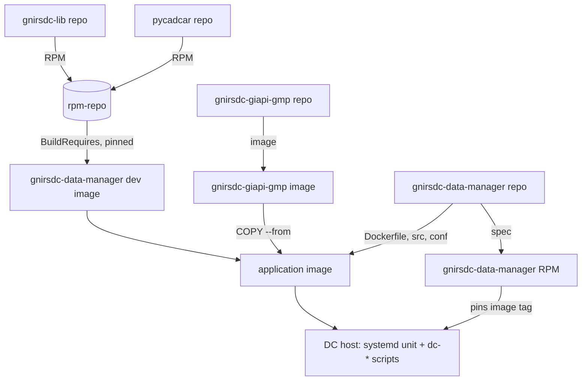
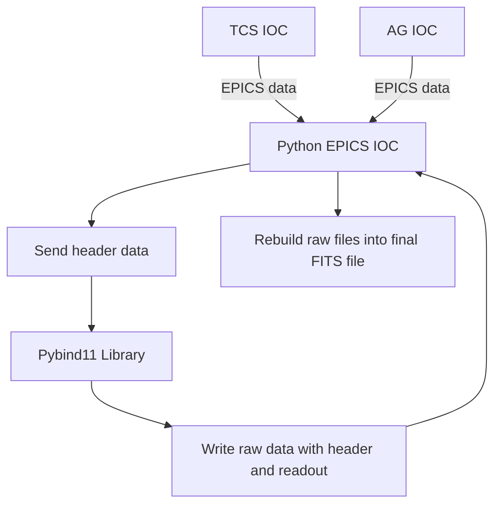

# Detector Controller Software

The DC software is a collection of Python scripts and Bash scripts for managing the Detector Controller Software and GMP containers. It is designed to work with an SDSU ARC (San Diego State University Astronomical Research Cameras) controller.

The software is run in Docker containers, providing isolation and portability. It can be interfaced with through either an HTML-based [System Manager](#system-manager), a PyDM screen, or Bash control scripts.

The GMP (Gemini Master Process) is used for GIAPI (Gemini Instrument Application Programming Interface) communication. It works in conjunction with the GDS (Gemini Data System) to process FITS files.

## Quick Start Guide

1. **Ensure the ARC controller is powered on**
   - Follow the Quick Fix page instructions to power cycle GNIRS DC.
   - You will see the ARC controller listed on the bootbar.
   - The status should be green indicating the controller is powered on.
   - If it is off you can power it on from the bootbar page.

2. **Access the System Manager**
   - Open a web browser and navigate to:
     ```
     http://gn-irdc-lp3:8080
     ```
   - This will open the System Manager interface, showing the Monitoring tab.

3. **Verify that the DC Software is running**
   - On the Monitoring tab, check the "GNIRS DC Health:" display.
   - Ensure that the green heartbeat indicator is blinking.

4. **Initialize the Detector Controller**
   - On the Monitoring tab, click the "Initialize Controller" button.
   - Select "Initialize Controller".
   - Click on the "Apply" button.
   - The "Controller Initialized:" status indicator should be green.

5. **Troubleshooting the DC Software**

   - **If the System Manager doesn't open**
      - SSH into the IRDC server:
     ```
     ssh telops@gn-irdc-lp3
     ```
      - Restart the System Manager service:
     ```
     sudo systemctl restart gnirsdc-system-manager
     ```
      - Open a web browser and navigate to `http://gn-irdc-lp3:8080`

   - **If the DC is not running**
      - Locate "Select Action" dropdown menu.
      - Select "Start Controller".
      - Wait for the DC to initialize.
      - Check the "GNIRS DC Health:" display again.
      - It may take a minute but should not take much more than that.
      - If the System Manager gives you SSH errors, see the SSH [Troubleshooting Issues on the IRDC Server with the Telops User](#ssh-authentication-issues-on-the-irdc-server-with-the-telops-user) section below.
         
      - If the DC is still not running, try the following:
         - Open a terminal and run the following command to SSH into the server:
     ```
     ssh telops@gn-irdc-lp3
     ```
         - Check the status of the DC software:
     ```
     dc-status.sh
     ```
         - You should see something like this:
     ```
     CONTAINER ID   IMAGE                                                     NAMES
     1ac26040939c   ghcr.io/gemini-rtsw/gnirsdc-data-manager:1.0.0-git...      gnirsdc
     05f3dde51464   ghcr.io/gemini-rtsw/gnirsdc-data-manager:1.0.0-git...      gmp
     ```


      - You should see the "**gnirsdc**" and "**gmp**" containers running
      - If you don't see this, something is wrong with the DC software.
      - Start the DC software manually with the following command:
     ```
     dc-start.sh
     ```
      - Check the status again.
      - If you still don't see it, contact software for support and check the logs for errors:
     ```
     tail -f /readout_data/logs/irdc.log
     ```

7. **Set Temperature Override (if needed)**
   <div style="color: red; font-weight: bold;">
       Warning: Overriding the temperature interlock can cause damage to the detector.
   </div>

   - Navigate to the Engineering tab by clicking "Engineering" in the top navigation bar.
   - Find the "Temperature Interlock Override" section.
   - Toggle the switch to enable or disable the temperature interlock override.
   - This allows operation even if the detector temperature is outside the normal range.


## Detector Controller Usage

1. SSH to one of the required IRDC servers (gn-irdc-lp1, gn-irdc-lp2, gn-irdc-lp3)

2. The [System Manager](#system-manager) runs as the `gnirsdc-system-manager`
   service and starts at boot. Check or restart it with:

   ```
   sudo systemctl status gnirsdc-system-manager
   sudo systemctl restart gnirsdc-system-manager
   ```

   If the DC is running in debug mode, set `SM_ARGS=--debug` in
   `/etc/sysconfig/gnirsdc` and restart the service.

3. Open a web browser and navigate to `http://<server ip address>:8080`

4. Use the System Manager web interface to monitor and configure the Detector Controller Software.

Alternatively, you can use the following commands to manage the Detector Controller Software and GMP containers:

- To start:
  ```
  dc-start.sh [additional arguments]
  ```
  Example with additional arguments:
  ```
  dc-start.sh --top tgnirs
  ```

- To stop:
  ```
  dc-stop.sh
  ```

- To check status:
  ```
  dc-status.sh
  ```

## DM Screen Usage

From a workstation with access to the IRDC server (currently hbfcon03 and mkocon05)

```
irdc_dm.sh
```

From a remote system

```
ssh -X <irdc server> "irdc_dm_server.sh"
or 

```
ssh -X <irdc server> 
irdc_dm_server.sh
```

## Data Retrieval

Raw data is stored in the `/readout_data/fits` directory on the IRDC server.

```
/readout_data/fits
```

Once processed the data is moved to the `/staging/perm` directory on the IRDC server.

```
/staging/perm
```

Use the web interface to navigate to the data and download it to a local system for viewing.

Alternatively you can scp the data to a local system for viewing.

Example:

``` 
scp <user>@<server>:/readout_data/fits/* .
```


## Detector Controller (DC) Operation Scripts

Installed by the `gnirsdc-data-manager` RPM in `/usr/local/bin`. The System
Manager runs `dc-start.sh` and `dc-stop.sh` over SSH for Start/Restart/Stop DC.

### dc-start.sh
Starts the `gmp` and `gnirsdc` containers from the image pinned by the installed RPM.
```
Usage: dc-start.sh [additional arguments]
```
- Additional arguments are passed to the `gnirsdc` container.
- Example: `dc-start.sh --top tgnirs` (for debug mode)
- `--help` shows the pinned image.

### dc-stop.sh
Stops the Detector Controller Software and removes related Docker containers.
```
Usage: dc-stop.sh
```
- No additional flags or arguments.

### dc-status.sh
Checks and displays the status of the Detector Controller Software containers.
```
Usage: dc-status.sh
```
- No additional flags or arguments.
- Displays running status of `gnirsdc` and `gmp` containers.

### gnirsdc-system-manager (systemd)
Runs the System Manager web interface; see [System Manager](#system-manager).
```
sudo systemctl status|restart gnirsdc-system-manager
```

Versions are managed with the RPM -- `dnf upgrade` / `dnf downgrade
gnirsdc-data-manager` -- which replaces the old current/production image tags;
see [Versions, upgrades and rollback](#versions-upgrades-and-rollback).

Note: These scripts should be run with appropriate permissions, typically as the 'telops' user or a user with Docker access.   

## Note

Your user on the IRDC server must be a memeber of the docker group

## Driver 

The DC uses the SDSU PCIe driver. The driver is officially supported on linux kernel 2 and 3. We run it on kernel 4. We have not had kernel issues on kernel version 4.18.0-348.20.1.el8_5.x86_64 and older.

``` 
Kernel on gn-irdc-lp1 and gn-irdc-lp3
4.18.0-348.20.1.el8_5.x86_64
```

The driver code and installation instruction are in this repository:

``` 
https://gitlab.com/nsf-noirlab/gemini/rtsw/iocs/gnirs-pci-driver
```

## Docker Login

The images are on GHCR (`ghcr.io/gemini-rtsw/...`). The gnirsdc-system-manager
service pulls the pinned image **as root**, and the System Manager starts the DC
containers from that same local image, so root needs read access to GHCR unless
the package is public:

1. Create a GitHub personal access token (classic) with the `read:packages`
   scope: github.com/settings/tokens.
2. Log root in once:
   ```
   echo "<token>" | sudo -H docker login ghcr.io -u <github-username> --password-stdin
   ```
   `-H` makes it land in `/root/.docker/config.json`.

**Note:** Ensure that your user on the IRDC server is a member of the `docker` group.

# gnirsdc-lib

gnirsdc-lib is a C++ library with Python bindings (using Pybind11) designed to control the SDSU ARC (San Diego State University Astronomical Research Cameras) controller. It handles firmware loading and execution of firmware calls.

It lives in its own repo, [gnirsdc-lib](https://github.com/gemini-rtsw/gnirsdc-lib),
and is published as the `gnirsdc-lib` RPM (EL9, Python 3.9). This repo picks it
up through the pinned `BuildRequires` in `packaging/gnirsdc-data-manager.spec`;
see [What goes into the image](#what-goes-into-the-image). Its README covers
building and testing it.


## Development
Work in the application image with this checkout mounted (see [Debug Setup](#debug-setup)):
it has Python 3.9, cppyy, the GIAPI glue, GMP, and the pinned gnirsdc-lib and
pycadcar. Inside it:
- Start GMP (host networking): run the image with `--entrypoint /gnirsdc/entrypoint-gmp.sh`
- Run the TCS simulator: `python3 test/tcs_simulator.py`
- Start the Data Manager IOC (debug, test top): `python3 src/gnirsdm.py --debug --top tgnirs`
- Launch the System Manager: `python3 src/system_manager_server.py --debug`
- Verify PVs via System Manager Monitoring tab or EPICS tools (`caget`, `caput`).

To build the RPM and image exactly as CI does:
```bash
./gemini-rtsw-ci/build_rpm.sh --el 9 --spec packaging/gnirsdc-data-manager.spec
./gemini-rtsw-ci/build_app_image.sh --no-push
```
To build against a gnirsdc-lib or pycadcar build that is not in rpm-repo yet,
drop its RPM in `local-rpms/` (gitignored) and match the spec's pin to it.

### etc
- If GIAPI libraries aren't found, ensure `GIAPI_ROOT` and `LD_LIBRARY_PATH` are set (the image sets both). For ad-hoc shells: `source $GIAPI_ROOT/defineGiapiglueEnv.sh`.
- Ensure `EPICS_CA_ADDR_LIST` is reachable (configured in `conf/gnirsdc/config.ini`; applied by `gnirsdm.py` at startup).

# libgnirsioc python cmd line use
Minimal sanity in dev container:
```bash
python3 - << 'PY'
import libgnirsioc
ctx = libgnirsioc.TCSContext()
print('TCSContext:', ctx)
PY
```
Full controller usage is via EPICS CADs in `gnirssdsu.py` (operate with System Manager or EPICS tools).

# how do run debug modes
Quick flow (see [Debug Setup](#debug-setup) for full details):
- Start GMP: `docker run -d --network=host --name gmp --entrypoint /gnirsdc/entrypoint-gmp.sh ghcr.io/gemini-rtsw/gnirsdc-data-manager:latest`
- Start TCS simulator: `python3 test/tcs_simulator.py`
- Start IOC: `python3 src/gnirsdm.py --debug --top tgnirs`
- Start System Manager: `python3 src/system_manager_server.py --debug`

## collect_dataset.py
Drive a sequence of exposures for dataset collection.
- Location: `test/collect_dataset.py` (expects top `tgnirs:`; change prefix if needed).
- Requires `test/collect_config.txt` lines with fields:
  - 0: LNRS (low-noise reads)
  - 1: ADC digital averages
  - 2: Sequence count (# exposures)
  - 3: Drop readouts (UTR)
  - 4: Well depth ("0.3" or "0.6")
  - 5: Up-the-ramp mode (0 normal, 1 UTR)
  - 6: Include engineering data (0/1)
- Example:
  ```
16 16 3 0 0.6 0 0
1 16 5 0 0.3 0 1
  ```
- Run:
  ```bash
python3 test/collect_dataset.py
  ```
Monitors `tgnirs:dc:applyC.VAL` to detect readout start/end; drives `dc:*`, `archive_fits`, `include_eng`.

# run dm screen
The DM screen offers an operator UI outside System Manager.
## linux
- If you have X11 and network access to the IRDC server:
```bash
irdc_dm.sh
```
- Or via SSH with X forwarding:
```bash
ssh -X <irdc server> "irdc_dm_server.sh"
# or
ssh -X <irdc server>
irdc_dm_server.sh
```
## mac
- Install XQuartz, allow network clients (Preferences → Security), then:
```bash
export DISPLAY=host.docker.internal:0
./irdc_dm_server.sh
```

# debug mode in vscode
Use the Dev Container steps above. `--debug` selects the `DEBUG` section of `conf/gnirsdc/config.ini`, using test EPICS tops (`tgnirs:`) and test TCS/AG prefixes.


## GNIRS WCS Procedures

The WCS files are stored in `/gemini/GEM5/gnirs/DC/DC/data/`, and they have names like "gnirs_3_short.wcs".

Update this web page so that we can keep track of WCS changes: internal.gemini.edu/science/instruments/GNIRS/Systems_Reference/wcs/gnirsWCS.html

The WCS depends on the hotspot, so if the hotspot is significantly off and there are huge offsets, gwcs may fail in very weird ways, and you may need to start with the single star method.

Typically, we check the WCS for GNIRS short blue camera.

### Using an "astrometric field"

If you've doing the hotspot, IAA, checkouts already just skip to step 5.

1. Choose a field with a bright star at the center and many Gaia/2MASS stars in the field
2. Check that science fold values have been updated and are correct
3. Slew to the astrometric field
4. Do GNIRS hotspot and Refine the IAA if necessary
5. Take an image
6. Run gwcs to derive new WCS. If you've done the IAA checkouts, the output from giaa gives WCS offsets (WCS dX, WCS dY)
7. If WCS is good within 1-2 arcseconds then don't do anything. otherwise continue with the rest of the steps
8. Follow the 'Adjusting the WCS with shiftwcs.sh' and 'Using offsets with a single star below'
9. Upload the WCS file if needed to `/gemini/GEM5/gnirs/DC/DC/data/`. Note the shiftwcs.sh script automatically makes a backup of the original WCS file, so you don't need to manually make a backup
10. Reload the WCS file if needed (Mark/Start) using the initWcsCAD (DC-->Additional Screens-->initWcsCAD)
11. Take another image and re-run gwcs to confirm the new WCS

### Adjusting the WCS with shiftwcs.sh

Log in to gemvx@pisces and run the shiftwcs.csh script using the offsets outputted by WCS. This script should be located in `/home/gemvx/bin/shiftwcs.sh`. Go to the directory where the NIRI wcs are stored and run this script. Note the script automatically backups the original copy of the WCS so you can revert back to it if needed.

```
shiftwcs.sh - shift an instrument WCS

SYNOPSIS

shiftwcs.sh [-p] wcsfile xshift yshift

DESCRIPTION

Make a backup of the supplied WCS file by appending it's last modification date, then shift the WCS file in X and Y. By default the supplied X and Y shifts are assumed to be in arcseconds. One may give offsets in pixels with the -p option. Note that shifts in arcseconds are in the TELESCOPE reference frame, and shifts in pixels are in the DETECTOR reference frame. For this reason it may be more intuitive to apply shifts in pixels, although shifts due to hotspot changes may be easier to apply in arcseconds.

OPTIONS

-p : Apply shifts in pixels instead of arcseconds
```

Reload the WCS file (Mark/Start) using the initWcsCAD (DC>Additional Screens)
Take another image to confirm the new WCS (make sure the compass on the QuickLook Tool is correct)

### Using offsets with a single star (when there are less than ~9 stars in the field)

1. Choose a field with a single bright star
2. Have the SOS center the star on the CR center while guiding
3. Create an observation with ~10 offsets which move the star to the field extremes, starting and ending at (0,0)
4. Record the instrument offsets (X,Y) from the TSD for each position (instrument offsets are NOT the P,Q offsets in the OT offset iterator!)
5. Use IRAF imexam "r" to record the star position on each image (in pixels)
6. Create a "raw" coordinate file with the image number, Instrument offsets and Image coordinates:

```
> cat gnirs.raw
# N     Instrument      Image
#       X       Y       X       Y
232     2.66   7.08     511.00  512.51
233     -5.37 15.05     878.21 145.36
234     -5.30 -0.95     144.91 148.78
235     10.63 15.12     878.95 876.40
236     10.70 -0.88     145.26 879.84
237     2.66   7.08     511.16 513.69
```

7. Create the wcs file by running this raw file through awk:
```
awk '$1>0 {printf "%6.2f %6.2f  %8.4f %8.4f\n", $4,$5,$2/1.61144,$3/1.61144}' gnirs.raw > gnirs.wcs
```

This will:
- convert the Instrument offsets from arcseconds to millimeters by dividing by 1.61144
- re-order the columns to be Image Coordinates (x,y) and Instrument Offsets (x,y)

```
> cat gnirs.wcs
511.00 512.51    1.6507   4.3936
878.21 145.36   -3.3324   9.3395
144.91 148.78   -3.2890  -0.5895
878.95 876.40    6.5966   9.3829
145.26 879.84    6.6400  -0.5461
511.16 513.69    1.6507   4.3936
```

8. Update the WCS file on pisces
9. Make a backup of the old WCS file (if there isn't one already):
```
mv gnirs_3_short.wcs gnirs_3_short.wcs.date
```
10. Copy the new WCS file: (the syntax is p<port>f<camera><altair>.wcs)
```
scp gnirs.wcs gemvx@pisces:/gemini/GEM5/gnirs/DC/DC/data//gnirs_3_short.wcs
```
11. Reload the WCS file (Mark/Start) using the initWcsCAD (DC>Additional Screens)
12. Take another image to confirm the new WCS (make sure the compass on the QuickLook Tool is correct)

R. Mason 20130424

updated 2018 Nov 27 - astephens + MES

## Build Architecture

Each piece is built in its own repo by gemini-rtsw-ci and published as an RPM or
image; this repo's spec and Dockerfile pin the exact versions it uses.



1. gnirsdc-lib and pycadcar publish RPMs to the shared rpm-repo.
2. This repo's build environment installs them at the versions pinned in the
   spec; that environment is published as the dev image.
3. The application image is built from the dev image, adds the Python packages,
   cppyy, the GIAPI glue and GMP server (from gnirsdc-giapi-gmp), and this repo.
4. The RPM pins that image; installing it on the DC host is the deployment.


# System Manager

The System Manager is a web-based interface for monitoring and configuring the Detector Controller Software. It provides an easy-to-use interface for viewing system status, editing configuration files, and performing various actions.

## Usage

## Usage

The System Manager runs as the systemd service `gnirsdc-system-manager`
(installed by the `gnirsdc-data-manager` RPM) and starts at boot. Its container
runs as the telops user, which must have an SSH key set up (it runs the `dc-*`
scripts on the host over SSH). If you haven't set up an SSH key yet, you can do so by running:

```
ssh-keygen
```

```
sudo systemctl status gnirsdc-system-manager
sudo systemctl restart gnirsdc-system-manager
journalctl -u gnirsdc-system-manager -f
```

To run it in debug mode, set `SM_ARGS=--debug` in `/etc/sysconfig/gnirsdc` and
restart the service.
## Features

The System Manager offers several features accessible through different tabs:

1. **Monitoring**: View the current status of the system, including:
   - GNIRS DC Health
   - GNIRS DC State
   - Epics Top
   - GDS Connection
   - TCS Connection
   - Temperature
   - Controller Initialization
   - Temperature Interlock
   - Detector Bias Voltage

2. **Config Editor**: Edit the configuration file directly through the web interface.

3. **Logs**: View and download log files.

4. **FITS Files**: Browse and download FITS files from both staging and readout directories.

5. **README**: View the README file with a table of contents for easy navigation.

### Monitoring Tab

The monitoring tab provides real-time updates on various system parameters and allows users to perform actions such as:
- Initializing the controller
- Clearing errors
- Applying TDL
- Starting and stopping the controller
- Setting integration parameters
- Starting integration

### Config Editor Tab

The Config Editor tab allows users to modify the configuration file (`config.ini`) directly through the web interface. Changes are saved and applied immediately.

### Logs Tab

The Logs tab provides access to log files stored in the configured log directory. Users can view and download these logs for troubleshooting and monitoring purposes.

### FITS Files Tab

The FITS Files tab allows users to browse, view headers, and download FITS files from both the staging and readout directories.

### README Tab

The README tab displays the contents of the README file with a table of contents for easy navigation.

## Technical Details

The System Manager is built using:
- Flask: A lightweight WSGI web application framework
- Caproto: A pure-Python channel access protocol library
- Server-Sent Events (SSE): For real-time updates without polling
- Paramiko: For executing SSH commands on the host machine

Key features of the code include:
- Custom `AlignedCasePreservingConfigParser` for maintaining the format of the config file
- Real-time PV updates using Caproto subscriptions
- Integration with EPICS for controlling and monitoring the detector
- SSH command execution for starting and stopping the controller

## Note

Ensure that you have the necessary permissions to read and write the configuration file (`conf/gnirsdc/config.ini`) and access the log and FITS file directories when using the System Manager.


# Building, Releasing and Deploying

This repo is built by [gemini-rtsw-ci](https://github.com/gemini-rtsw/gemini-rtsw-ci).
Every push to `main` builds:

- the **`gnirsdc-data-manager` RPM** (`packaging/gnirsdc-data-manager.spec`),
  published to the shared rpm-repo: the systemd unit, the `dc-*` scripts and
  `/etc/sysconfig/gnirsdc`
- the **application image** from `Dockerfile`, pushed as
  `ghcr.io/gemini-rtsw/gnirsdc-data-manager:<version>-git<hash>` -- the tag the
  RPM pins

A pull request builds both and publishes neither; its RPM is attached to the
run as an artifact. See the gemini-rtsw-ci WORKFLOW.md for the full flow.

## What goes into the image

The image is built on this repo's dev image, which contains everything the
spec pins in `BuildRequires`: **gnirsdc-lib** (libgnirsioc) and **pycadcar**
(pygeminirec), at the exact builds named there. The GIAPI C++ glue and the GMP
server come from **gnirsdc-giapi-gmp**, pinned by version in the `Dockerfile`.

To move to a new gnirsdc-lib or pycadcar build, merge it in its own repo, copy
the new version from the "BUILD DEPENDENCY VERSIONS" block of its green build
into the spec's `BuildRequires`, and merge that here.

## Versions, upgrades and rollback

The installed RPM decides what runs: the unit and `dc-start.sh` both pin this
release's image, so all three containers (System Manager, gnirsdc, gmp) run it.

```bash
rpm -q gnirsdc-data-manager                       # what is installed, and so what runs
sudo dnf upgrade gnirsdc-data-manager             # move forward
sudo dnf downgrade gnirsdc-data-manager           # roll back
dnf list --showduplicates gnirsdc-data-manager    # every published build
sudo systemctl restart gnirsdc-system-manager     # then Restart DC from the web page
```

The DC keeps running its current image until it is restarted from the System
Manager, so an upgrade never interrupts an observation by itself.

To try an unreleased build (for example a pull request's image), set
`GNIRSDC_IMAGE` in `/etc/sysconfig/gnirsdc`, restart the unit and Restart DC;
clear it again afterwards.

## First install on a DC host

```bash
sudo dnf install gnirsdc-data-manager
sudo vi /etc/sysconfig/gnirsdc                    # SM_USER (telops), SM_ARGS
sudo systemctl enable --now gnirsdc-system-manager
```

Root must be able to pull from GHCR (see [Docker Login](#docker-login)).

# Changing TCS Process Variable (PV) in the TCS context



*Figure 1: Data flow diagram showing how TCS and AG IOCs provide EPICS data to the Python EPICS IOC, which then processes the data through the Pybind11 library to create FITS files with proper headers.*

## 1. Modify the `fits_header_definitions.py` file
- **File path:** `src/fits_header_definitions.py`
- **Task:** Add the new TCS PV and ensure it is included in the TCS context.

- **Example change:**

```python
  # Define the new PV in the `define_hdu_list` function
  tcs_instr_pa = pdu.get('TCS_INSTR_PA', '')
  
  # Update the tcs_connected check to include the new PV
  tcs_connected = all([tcs_ra, tcs_dec, tcs_frame, tcs_equinox, tcs_time, tcs_port, tcs_camera, tcs_ao, tcs_instr_pa])
  
  # Add the new PV to the tcs_context dictionary
  tcs_context = {
      'instr_pa': tcs_instr_pa,
      # Other existing context entries...
  }
```

## 2. Modify the `tcs_monitor.py` file
- **File path:** `src/tcs_monitor.py`
- **Task:** Add the new PV to the `TCSMonitor` class to track the new TCS value.

- **Example change:**

```python   
  # Add the new PV to the `self.tcs_pvs` list
  self.tcs_pvs = [
      # Other existing PVs...
      f'{tcs_prefix}sad:instrPA',  # 'instrument position angle'
      f'{cc_prefix}cc:cameraPosition',  # 'camera' (optional)
  ]
  
  # Map the new PV to its corresponding TCSContext attribute
  mapping = {
      'instrPA': 'inst_pa',  # Changed from 'camera' to 'instrument_pa'
      # Other mappings...
  }
```

## 3. Update the Context Mapping
- Ensure the new PV is mapped correctly to the TCS context within the `mapping` dictionary in `tcs_monitor.py`. This will make sure the context is updated with the value from the new PV.

- **Example change in `mapping`:**

```python
  mapping = {
      # Other mappings...
      'instrPA': 'inst_pa',  # Ensure new PV is mapped correctly
  }
```

## Recap
1. **In `fits_header_definitions.py`:**
   - Add the new PV (`TCS_INSTR_PA`).
   - Update the `tcs_connected` check.
   - Include the new PV in the `tcs_context`.

2. **In `tcs_monitor.py`:**
   - Add the new PV to the `self.tcs_pvs` list.
   - Map the new PV to its corresponding attribute in the `mapping` dictionary.

# Detector Controller Software


## Debug Setup

For debugging, run everything from the application image with this checkout
mounted at `/work` (on macOS, `dc-mac-test.sh` does all of this for you; see
[macOS Debug Setup](#macos-debug-setup)).

1. **Start the GMP Server:**
   ```bash
   docker run -d --network=host --name gmp \
     -v /readout_data:/readout_data -v /staging/perm:/staging/perm \
     --entrypoint /gnirsdc/entrypoint-gmp.sh \
     ghcr.io/gemini-rtsw/gnirsdc-data-manager:latest
   ```

2. **Start a development container:**
   ```bash
   docker run -itd --name gnirsdc-dev --privileged --network=host \
     -v `pwd`:/work --entrypoint bash \
     ghcr.io/gemini-rtsw/gnirsdc-data-manager:latest -l
   docker exec -it gnirsdc-dev bash -l
   ```
   The image already sets the GIAPI environment (`GIAPI_ROOT`, `LD_LIBRARY_PATH`).

3. **Run the TCS Simulator** (inside the container, from `/work`):
   ```bash
   python3 test/tcs_simulator.py
   ```

4. **Start the GNIRSDC Data Manager** in debug mode:
   ```bash
   python3 src/gnirsdm.py --debug --top tgnirs
   ```
   Note: --debug is optional. If you don't use --debug the DC will attempt to connect to an ARC.

5. **Launch the System Manager Server** in debug mode:
   ```bash
   python3 src/system_manager_server.py --debug
   ```
   Note: --debug flag tells the System Manager to use the tgnirs top. It is inconsistent with the --top flag in DC.

By following these steps, you'll have a complete debug environment set up with the GMP server, TCS simulator, GNIRSDC Data Manager, and System Manager Server all running in their respective containers or processes.


## Troubleshooting

### SSH Authentication Issues on the IRDC Server with the Telops User

If you encounter SSH authentication errors starting or stopping the controller from the System Manager, check the permissions and keys for the telops user. All of these commands are run on the IRDC server (gn-irdc-lp1 or gn-irdc-lp3 for example).

1. Set the correct permissions for the SSH directory and keys:

   ```bash
   chmod 700 /home/telops/.ssh
   chmod 600 /home/telops/.ssh/id_rsa
   chmod 644 /home/telops/.ssh/id_rsa.pub /home/telops/.ssh/authorized_keys
   ```

2. If the issue persists, you may need to regenerate the SSH key:

   ```bash
   mv /home/telops/.ssh/id_rsa /home/telops/.ssh/id_rsa.old
   mv /home/telops/.ssh/id_rsa.pub /home/telops/.ssh/id_rsa.pub.old
   ssh-keygen -t rsa -b 4096 -f /home/telops/.ssh/id_rsa -N ""
   ```

3. Update the authorized_keys file with the new public key:

   ```bash
   cat /home/telops/.ssh/id_rsa.pub > /home/telops/.ssh/authorized_keys
   ```

4. Restart the system manager:

   ```bash
   sudo systemctl restart gnirsdc-system-manager
   ```

After performing these steps, try starting the controller again. If you continue to experience issues, please consult the system logs or contact software for support.


## Building the SDSU Firmware

The production firmware the DC loads is `src/firmware/AladdinIII_SDSU_Firmware.lod`
in this repo, with its DSP source in `src/firmware/src`. Archived builds in
`firmware-archived/` can be selected from the Engineering tab (legacy firmware
mode).

The DSP56K assembler runs under gemini-wine (see the
[gnirsdc-dsp](https://github.com/gemini-rtsw/gnirsdc-dsp) repo and its
`build-firmware.sh`, which takes the Wine image from `WINE_IMAGE`). gemini-wine
has not been migrated to GHCR, so the assembler is not available in CI.

To change the production firmware:

1. Assemble the new `.lod` and copy it over `src/firmware/AladdinIII_SDSU_Firmware.lod`.
2. To try it before releasing, copy it into the running container and reinitialize
   the controller from the System Manager:
   ```bash
   docker cp AladdinIII_SDSU_Firmware.lod gnirsdc:/gnirsdc/src/firmware/
   ```
3. Commit it and open a pull request; the next release's image carries it.

# macOS Debug Setup

`dc-mac-test.sh` starts GMP and a dev container from the released image, then
the TCS simulator, the IOC (`--debug --top tgnirs`) and the System Manager inside
it, with this checkout mounted at `/work`:

```bash
./dc-mac-test.sh                 # start everything; web UI on http://localhost:8080
./dc-mac-test.sh logs ioc        # tail logs: tcs-sim | ioc | sm
./dc-mac-test.sh stop
IMAGE=ghcr.io/gemini-rtsw/gnirsdc-data-manager:<tag> ./dc-mac-test.sh   # a specific build
```

Docker must be able to run amd64 images (Rosetta in Docker Desktop, or Colima
with `--vz-rosetta`); see the gemini-rtsw-ci README, "Building on Apple Silicon".

Note: The `--debug` flag is important as it tells the components to run in debug mode without attempting to connect to actual hardware.